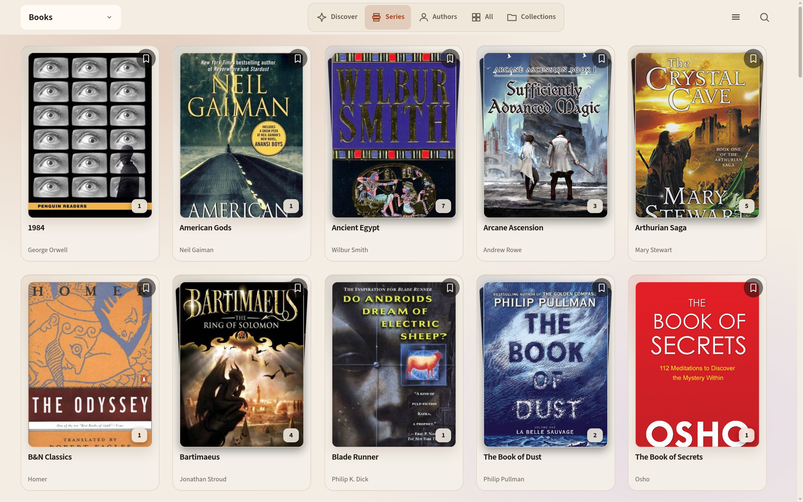
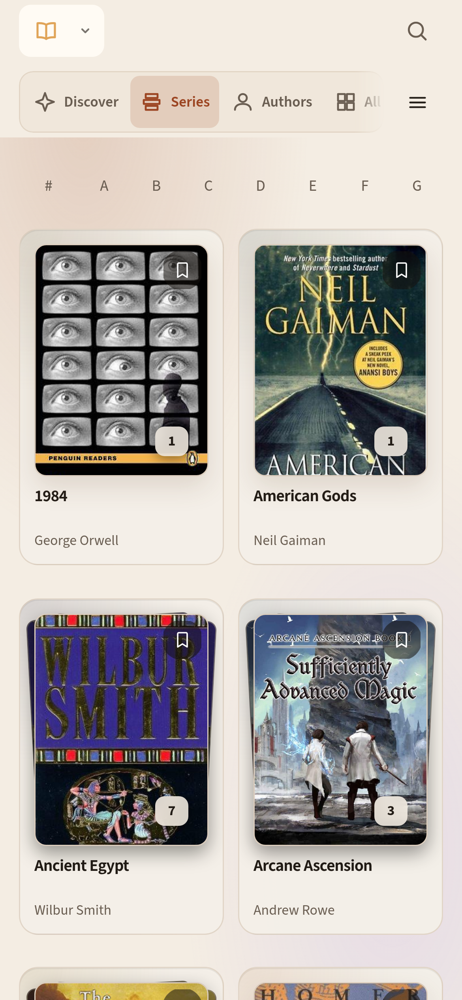
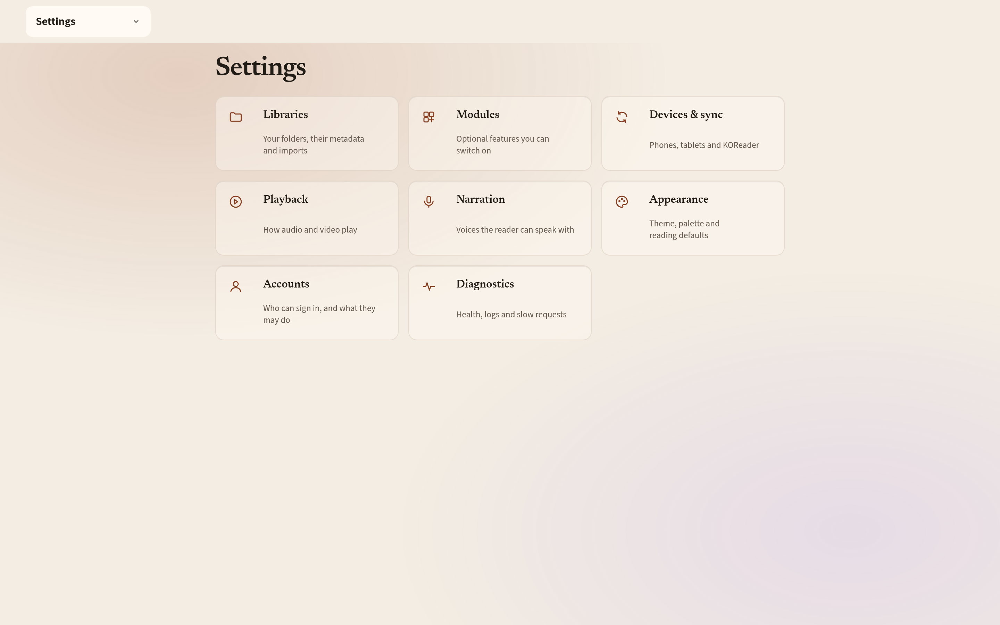

# Mochil

One place for the books, comics, manga, audiobooks, podcasts and video I already own.

Mochil is a small server you run yourself. It reads the folders you already have, shows them in a
browser, and serves them to an Android app, a Kobo running KOReader, or any OPDS reader. No database,
no import step, no files moved. Point it at a folder and it is there.



| Phone | Settings |
|---|---|
|  |  |

## Why this exists

I wanted one app instead of six. Calibre for books, something else for comics, another thing for
audiobooks, Jellyfin for video, and a sync service on top of all of it. Each one had its own login,
its own idea about my files, and its own way of hiding things I already had.

Mochil is my attempt at the small version: one server, one interface, my own folders as the source
of truth. Delete the cache and it rebuilds by scanning. Stop using it and the files are still just
files.

## Install

You need Docker. One command gets you running:

```bash
docker run -d --name mochil \
  --restart unless-stopped \
  -p 8099:8080 \
  -v /path/to/your/media:/media \
  -v /path/to/mochil/config:/config \
  -v /path/to/mochil/data:/data \
  -e TZ=Europe/Brussels \
  -e MOCHIL_BROWSE_ROOTS=/media \
  -e MOCHIL_UID=1000 -e MOCHIL_GID=1000 \
  ghcr.io/kevindherdt/mochil:latest
```

Or with compose, which is easier to keep around. `compose.yaml`:

```yaml
services:
  mochil:
    image: ghcr.io/kevindherdt/mochil:latest
    restart: unless-stopped
    ports:
      - "8099:8080"
    volumes:
      - /mnt/media:/media                 # your books, comics, audiobooks, video
      - ./mochil/config:/config           # settings; back this up
      - ./mochil/data:/data               # caches, accounts, reading state
    environment:
      TZ: Europe/Brussels
      MOCHIL_BROWSE_ROOTS: /media         # where the folder picker starts
      MOCHIL_UID: "1000"                  # owner of your media files
      MOCHIL_GID: "1000"
```

And `.env`, next to it:

```dotenv
# Optional. Leave both empty and the first visit asks you to create the account.
MOCHIL_USERNAME=
MOCHIL_PASSWORD=
```

```bash
docker compose up -d
```

Open `http://your-server:8099`. The first page asks you to create the account, then drops you in
Settings, where **Add a folder…** picks a library from your media folder and fills in the details
from what it finds there.

Three folders matter, and only two are precious:

- `/media` is yours. Mochil reads it and never writes there unless you point a library at it for
  renaming.
- `/config/config.json` holds your libraries and settings. Back it up.
- `/data/catalogs/` holds accounts, paired devices and reading progress. Back that up too.
- The rest of `/data` is cache. Delete it whenever; it comes back by rescanning.

To upgrade, `docker compose pull && docker compose up -d`. Settings live in the mounted `/config`,
so they survive.

## What it does

Books and comics open in the browser with a real reader, and the same book opens on a phone or a
Kobo at the page you left. Manga and comics read right to left when they should. Audiobooks and
music play with progress remembered across devices. Video streams with an optional narration track.
Podcasts download for offline listening.

Libraries can be plain folders or a Calibre library, and Calibre's own metadata is used when it is
there. Covers and details can come from Open Library, Hardcover or TMDB if you want them.

Any OPDS reader can browse the same catalogue, so a Kobo or another app works without the Mochil app
at all.

## The Android app

The app pairs with your server once and then keeps its libraries offline for flights and dead zones.
It talks to the server over your own network or Tailscale, so a plain http address is fine at home.
A reverse proxy with https is only needed if you expose it to the internet.

## How this was made

Mochil was built with AI assistance. I designed it, chose how it behaves, tested it against my own
library, and decided what shipped and what did not. The code was written largely by models under
that direction, reviewed and corrected the same way.

I know a lot of people have strong feelings about that, and I am not going to pretend otherwise.
This is a proof of concept with a specific idea behind it: a lightweight, minimal replacement for
several apps I was paying for and maintaining, built to my taste and my library. If it is not to
your taste, the files are still just folders and every other reader can open them.

## Status

Early. Version 0.1.x is the first public line and it changes quickly. The web app, the Android app
and the reading plugin share the same version number. Back up `/config` and `/data/catalogs` before
upgrading.

Release notes for every version are on the [releases page](https://github.com/kevindherdt/mochil/releases).

## Licence

AGPL-3.0. If you run Mochil and let other people use it over a network, the AGPL asks you to make
the source of your version available to them.

Forks are fine, under a different name and icon as described in [TRADEMARK.md](TRADEMARK.md).
See [LICENSE](LICENSE) for the full text.
