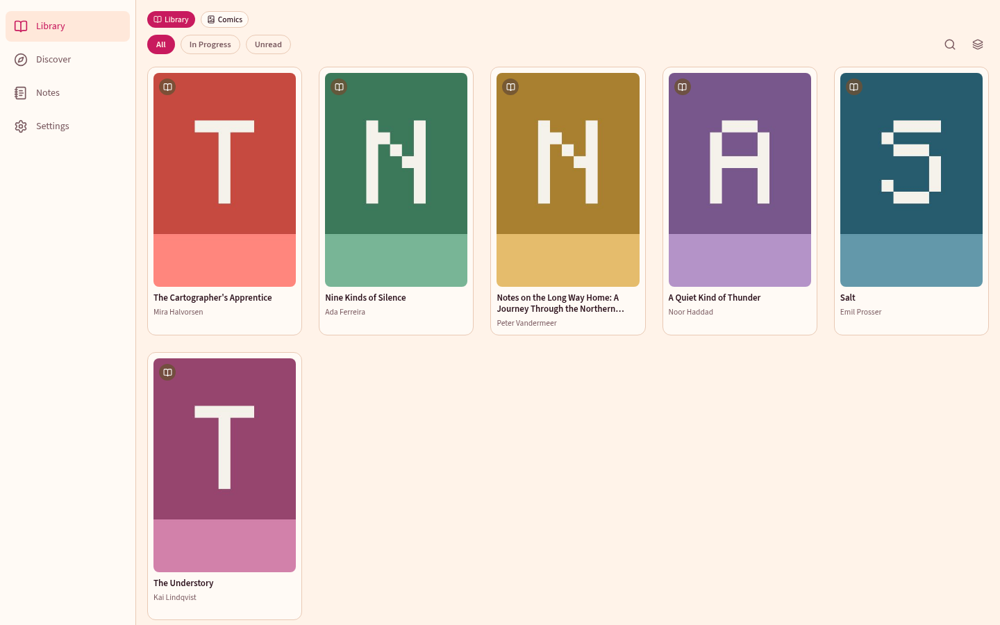
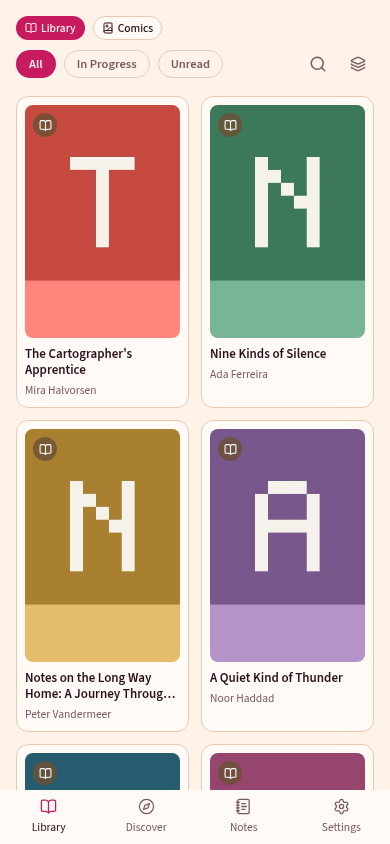

# Mochil

One place for the books, comics, manga, audiobooks, podcasts and video I already own.

Mochil is a small server you run yourself. It reads the folders you already have, shows them in a
browser, and serves them to an Android app, a Kobo running KOReader, or any OPDS reader. No database,
no import step for files you already have. Point it at a folder and it is there. Bringing files in
from somewhere else — another PC, a drop folder — is one optional step away, in Settings → Libraries.


| On a phone | Settings |
|---|---|
|  |  |

The books in these pictures are invented and their covers are drawn for the demo, so nothing here is
anyone else's artwork. Every picture is taken from the disposable demo instance (`scripts/ui-demo.sh`),
never from a real library.

### Themes

Four themes, each with its own accent and background rather than four shades of the same brown. Each
one has a dark and a light scheme that follows the device, and the Android app has the same set, so
the library looks the same wherever you open it.

| Deep Teal | Magenta Cream |
|---|---|
|  |  |



The other two are Ember (warm, the default) and E-ink (no gradients, no transitions, pure black and
white, for a Kobo or a matte screen).

## Why this exists

I wanted one app instead of six. Calibre for books, something else for comics, another thing for
audiobooks, Jellyfin for video, and a sync service on top of all of it. Each one had its own login,
its own idea about my files, and its own way of hiding things I already had.

Mochil is my attempt at the small version: one server, one interface, my own folders as the source
of truth. Delete the cache and it rebuilds by scanning. Stop using it and the files are still just
files.

## Install

You need Docker. One command gets you running:

```bash
docker run -d --name mochil \
  --restart unless-stopped \
  -p 8099:8080 \
  -v /path/to/your/media:/media \
  -v /path/to/mochil/config:/config \
  -v /path/to/mochil/data:/data \
  -e TZ=Europe/Brussels \
  -e MOCHIL_BROWSE_ROOTS=/media \
  -e MOCHIL_UID=1000 -e MOCHIL_GID=1000 \
  ghcr.io/kevindherdt/mochil:latest
```

Or with compose, which is easier to keep around. `compose.yaml`:

```yaml
services:
  mochil:
    image: ghcr.io/kevindherdt/mochil:latest
    restart: unless-stopped
    ports:
      - "8099:8080"
    volumes:
      - /mnt/media:/media                 # your books, comics, audiobooks, video
      - ./mochil/config:/config           # settings; back this up
      - ./mochil/data:/data               # caches, accounts, reading state
    environment:
      TZ: Europe/Brussels
      MOCHIL_BROWSE_ROOTS: /media         # where the folder picker starts
      MOCHIL_UID: "1000"                  # owner of your media files
      MOCHIL_GID: "1000"
```

And `.env`, next to it:

```dotenv
# Optional. Leave both empty and the first visit asks you to create the account.
MOCHIL_USERNAME=
MOCHIL_PASSWORD=
```

```bash
docker compose up -d
```

Open `http://your-server:8099`. The first page asks you to create the account, then drops you in
Settings, where **Add a folder…** picks a library from your media folder and fills in the details
from what it finds there.

Three folders matter, and only two are precious:

- `/media` is yours. Mochil reads it and never writes there unless you point a library at it for
  renaming.
- `/config/config.json` holds your libraries and settings. Back it up.
- `/data/catalogs/` holds accounts, paired devices and reading progress. Back that up too.
- The rest of `/data` is cache. Delete it whenever; it comes back by rescanning.

To upgrade, `docker compose pull && docker compose up -d`. Settings live in the mounted `/config`,
so they survive.

## What it does

Books and comics open in the browser with a real reader, and the same book opens on a phone or a
Kobo at the page you left. Manga and comics read right to left when they should. Audiobooks and
music play with progress remembered across devices. Video streams with an optional narration track.
Podcasts download for offline listening.

Libraries can be plain folders or a Calibre library, and Calibre's own metadata is used when it is
there. Covers and details can come from Open Library, Hardcover or TMDB if you want them.

Wrong metadata is fixable in bulk. The editor shows the whole library as one scrolling table: search
and sort across every book on the server, select one or a thousand, and change a field, a series or an
author in one go. Nothing is written until you have seen what would change, and every write can be
undone. ISBNs and Hardcover matches can be looked up across the whole library as a job that keeps
running when you close the tab.

Any OPDS reader can browse the same catalogue, so a Kobo or another app works without the Mochil app
at all.

## The Android app

The app pairs with your server once and then keeps its libraries offline for flights and dead zones.
It talks to the server over your own network or Tailscale, so a plain http address is fine at home.
A reverse proxy with https is only needed if you expose it to the internet.

**Get it:** [releases/latest/download/mochil-android.apk](https://github.com/kevindherdt/mochil/releases/latest/download/mochil-android.apk).
That URL always points at the newest build, so it is the one link worth bookmarking. It is a plain
client: it contains no server address and no credentials, and it asks you for your server the first
time it starts. `SHA256SUMS` on the same release lists the hash of every attached file.

To let your own server hand out app updates by itself, drop that APK into its data directory as
`mochil-android.apk` (in the container that is `/data`, and `/config/cache` works too). The app's
"Check for updates" then finds it, with the version the server was built against. Without a file
there the check answers honestly that this server does not host app builds.

## What Mochil is actually good at

Not everything here is finished, but these parts are the ones I rely on daily and would miss:

- **Your folders stay yours.** No import, no database owning your library. Delete every cache and it
  rebuilds by scanning. Stop using Mochil and nothing has to be exported.
- **One server for everything you already own** — books, comics, manga, audiobooks, music, podcasts,
  video — instead of five apps with five logins and five ideas about your files.
- **Reading that is really reading.** EPUB, PDF and CBZ in the browser, two engines to choose from,
  themes that include a genuine e-ink palette rather than a grey theme.
- **Progress that follows you.** The same book reopens where you left it on web, Android and a Kobo
  running KOReader, and highlights travel with it.
- **Comics and manga read the way they should** — right to left when they should be, vertical webtoon
  scrolling when that is the format, with the fit mode remembered.
- **It works offline where it matters.** The Android app keeps libraries downloaded for flights and
  dead zones, and still syncs when it sees the network again.
- **A small thing to run.** A single Go binary in a container, no database, no Java, no sidecars, no
  plugin ecosystem to keep alive.
- **Anything that speaks OPDS can use it**, so no device is locked out for lacking the Mochil app.
- **E-ink is treated as a target, not an afterthought**: palettes, motion and contrast are chosen for
  it rather than bolted on.

## Where it is still thin

Being honest about the other column, because you will find these before I fix them:

- **Settings still have some sprawl.** I keep pruning it, but a few niche options are still louder
  than they deserve to be.
- **Metadata is good, not magical.** Matching is stronger than most self-hosted libraries, but an
  odd folder or an unusual edition still needs a human.
- **It is a personal library, not a sharing platform.** Accounts exist; fine-grained sharing and
  per-user shelves are not the design goal.
- **Distribution is the weak link.** There is no store presence: the app is an APK from the releases
  page, installed by hand.
- **Sync is last-writer in the hard cases.** Two devices offline for a week on the same book resolve
  predictably, not cleverly.
- **Documentation trails the code.** I write it when something is settled, which means the newest
  corners are the least explained.
- **One person, no support desk.** Bugs are fixed when I hit them or when they are reported well.

## How this was made

Mochil was built with AI assistance. I designed it, chose how it behaves, tested it against my own
library, and decided what shipped and what did not. The code was written largely by models under
that direction, reviewed and corrected the same way.

I know a lot of people have strong feelings about that, and I am not going to pretend otherwise.
This is a proof of concept with a specific idea behind it: a lightweight, minimal replacement for
several apps I was paying for and maintaining, built to my taste and my library. If it is not to
your taste, the files are still just folders and every other reader can open them.

## Status: alpha, and what to expect

This is a **proof of concept in alpha**, even though it has quietly been my own daily driver for a
long time. Version 0.1.x means what it says: it is early, it moves, and the API, settings and storage
layout can still change. The web app, the Android app and the reading plugin share one version number.

Release notes for every version are on the [releases page](https://github.com/kevindherdt/mochil/releases).

What to expect from me:

- **Frequent change.** I am not easily satisfied with my own results, so polish lands continuously
  and features get rewritten when the first version is merely fine.
- **A long-term commitment.** This is not a weekend project I will abandon; it is the app I use to
  read every day, and it replaces a stack of paid apps for me.
- **Suggestions are welcome, decisions are mine.** Issues and ideas genuinely shape it, but I filter
  them through one philosophy: a minimalistic core that feels calm and personal, extended by modules
  rather than by adding settings to the middle of it. If an addition does not fit that, I will say so
  rather than ship it half-heartedly.
- **Prefer clarity over compatibility.** When something is wrong, I would rather change it than
  preserve it because it shipped that way once.

## No warranty — back up your data

Mochil comes with **no warranty of any kind** and I am **not responsible for data loss, corruption,
downtime, or anything else that goes wrong** if you run it. That is what the licence says, and it is
also just true: this is alpha software written by one person, and you are running it against files
you presumably care about.

Concretely, before you point it at anything:

- **Back up `/config` and `/data/catalogs`** before every upgrade. Those hold your libraries, accounts
  and reading progress.
- **Test on a copy first**, especially if you enable anything that writes — metadata edits, renaming,
  or library transfers. Those are the features that touch your files.
- **Keep your media source of truth outside Mochil.** It is designed to read your folders, not to
  own them, so your files should still make sense with Mochil uninstalled.
- Treat any feature that writes as "know where your backups are" territory, not "it will be fine".

## Licence

AGPL-3.0. If you run Mochil and let other people use it over a network, the AGPL asks you to make
the source of your version available to them.

Forks are fine, under a different name and icon as described in [TRADEMARK.md](TRADEMARK.md).
See [LICENSE](LICENSE) for the full text.
